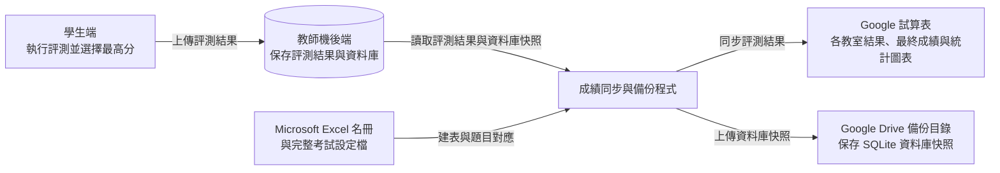
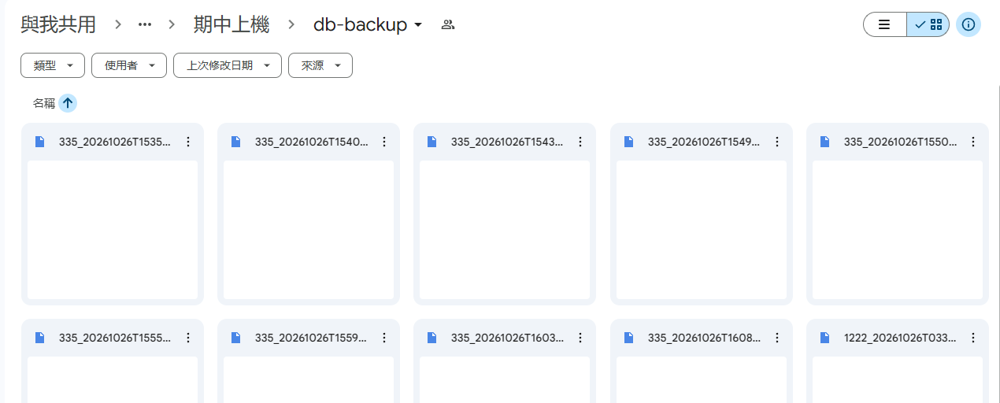

# 助教操作手冊：成績試算表與資料庫備份

本手冊供負責考試成績與備份的助教使用，適用於 `ntut-exam-score-gsheet-syncer`。你可以用它建立成績試算表、同步各教室的評測結果，以及把教師機的 SQLite 資料庫備份到 Google Drive。

## 1. 流程與目錄

### 1.1 考前準備流程

考前準備可在後端尚未啟動時完成。Google 授權、設定分享權限與建表需要連線到 Google；後端網址與管理權杖可先取得並填入 `.env`。

| 操作 | 相關段落 | 完成後得到什麼 |
| --- | --- | --- |
| 準備電腦、工具及本次考試檔案 | 第 2 節 | 可執行程式的部署資料夾、名冊與完整考試設定檔 |
| 確認檔案並完成登入 | 第 3.1 節確認檔案；第 3.2 節登入 | 已準備的檔案，以及備份需要的個人 Google Drive 授權 |
| 確認共享目錄權限並準備連結 | 第 4 節 | Google 試算表與既有備份資料夾的連結 |
| 從名冊與設定建立完整試算表 | 第 5 節 | 五個分頁、名冊、計分公式、統計與圖表 |
| 填寫本教室的連線與間隔設定 | 第 6.1 節；只備份時看第 8.1 節 | 已填好本教室資訊的 `.env` |
| 規劃多個教室或準備下一場考試 | 第 11 節 | 各教室的獨立部署資料夾與對應設定 |

### 1.2 考試時部署流程

完成所需的考前準備、啟動本教室後端後，依要使用的功能選擇流程，先預覽，再正式執行。此階段確認後端連線與後端管理權杖、預覽成績更新，並以成功上傳的資料庫快照驗證實際備份。

| 操作 | 相關段落 | 完成後得到什麼 |
| --- | --- | --- |
| 同步成績並定期備份 | 第 6.2～6.3 節 | 定期同步成績並備份 |
| 只同步成績 | 第 7 節 | 只定期同步本教室的成績試算表分頁 |
| 只備份資料庫 | 第 8 節 | 只定期上傳本教室的 `.sqlite` 備份 |
| 查看成績、處理異常 | 第 9 節、第 12 節 | 確認資料來源與處理方式 |
| 停止、重新啟動或考後收尾 | 第 10 節 | 完成最後同步與備份，保存交接資料 |

**操作原則：同一份試算表建表一次；每個教室各自執行同步。** `--setup-sheet` 會重建目標分頁；日常更新成績使用第 6 或第 7 節的同步流程。

**圖 01｜整體資料流**




## 2. 共通準備：資料夾、工具與檔案

### 2.1 準備執行環境

準備一台可連線到 Google 的電腦；考試時部署另需能連線到本教室教師機。持續同步時，電腦需保持開機、連線，執行程式的終端機也要保持開啟。

1. 取得本專案資料夾 `ntut-exam-score-gsheet-syncer`。
2. 安裝 Python 3.13 或更新版本，以及 [uv](https://docs.astral.sh/uv/getting-started/installation/)。
3. 在含有 `main.py` 的資料夾開啟 PowerShell 或 Bash。
4. 安裝鎖定版本的套件。

PowerShell：

```powershell
uv sync --frozen
```

Bash：

```bash
uv sync --frozen
```

完成檢查：指令成功結束，資料夾中產生 `.venv`。後續每次執行指令，都從此資料夾開始；本文的檔案路徑皆相對於此處。

### 2.2 取得本次考試資料

依使用功能取得下列檔案，放在部署資料夾。`drive_token.json` 會在第 3.2 節登入後自動產生。

| 檔案或資訊 | 向誰取得／如何準備 | 使用時機 |
| --- | --- | --- |
| `credentials.json` | 由維護考試系統的同學提供 | 建表、成績同步 |
| `drive_oauth_client.json` | 由維護考試系統的同學提供；建立流程見附錄 B | 首次 Google Drive 授權或重新授權 |
| `drive_token.json` | 助教依第 3.2 節登入自己的帳號後在本機產生 | 備份期間自動更新認證 |
| `roster.xlsx` | 由助教提供本次考試的 Microsoft Excel 名冊 | 建表 |
| `exam-config.json` | 由助教提供本次完整考試設定 | 建表、成績同步 |
| 後端網址、管理權杖 | 向維護考試系統的同學取得 | 成績同步、資料庫備份 |
| Google Drive 共享目錄網址 | 由維護考試系統的同學提供 | 確認 Google 服務帳戶編輯權限 |
| Google 試算表網址、Google Drive 備份資料夾網址 | 第 4 節取得 | 指定成績與備份目的地 |

全部功能的部署資料夾會像這樣：

```text
ntut-exam-score-gsheet-syncer/
  main.py
  uv.lock
  .env.template
  .env
  credentials.json
  drive_oauth_client.json
  drive_token.json
  roster.xlsx
  exam-config.json
```

只用部分功能時，依上表準備對應檔案即可。

## 3. 確認檔案並登入

### 3.1 確認檔案

- 建表或同步成績：確認 `credentials.json` 與 `exam-config.json` 在部署資料夾。
- 建表：確認 `roster.xlsx` 在部署資料夾。
- 備份：確認 `drive_oauth_client.json` 在部署資料夾。

### 3.2 登入 Google Drive

使用備份功能時，助教執行以下指令，登入具有共享目錄編輯權的學校 Google 帳號。只用成績同步或建表功能時，繼續第 4 節。

PowerShell：

```powershell
uv run python main.py --authorize-drive --oauth-client "drive_oauth_client.json"
```

Bash：

```bash
uv run python main.py --authorize-drive --oauth-client "drive_oauth_client.json"
```

1. 在開啟的瀏覽器選擇自己的學校 Google 帳號，完成同意。注意一定要用學校帳號。
2. 回到終端機，確認出現 `Google Drive authorization saved locally.`，且資料夾產生 `drive_token.json`。

程式會使用這個學校 Google 帳號上傳備份。

## 4. 確認共享目錄權限並準備連結

共享目錄是本課程既有的 Google Drive 共用資料夾，本次考試目錄與備份目錄都已備妥。

### 4.1 確認共享目錄權限並準備 Google 試算表

1. 開啟共享目錄，點選「共用」。確認 `credentials.json` 中 `client_email` 對應的 Google 服務帳戶為 **編輯者**。
2. 開啟既有的本次考試目錄，在其中建立 Google 試算表，以課程與考試名稱命名。
3. 開啟試算表的「共用」，將一般存取權設為 **知道連結的任何人 → 檢視者**。
4. 複製試算表網址。

本次考試目錄及其中的 Google 試算表繼承共享目錄的編輯權限。[Google 資料夾權限繼承說明](https://support.google.com/drive/answer/7166529?hl=en)

### 4.2 取得 Google Drive 備份資料夾連結

開啟既有的本次考試備份目錄，複製網址。

以下兩種網址都可使用，`FOLDER_ID` 換成實際識別碼：

```text
https://drive.google.com/drive/folders/FOLDER_ID
https://drive.google.com/drive/u/0/folders/FOLDER_ID
```

備份上傳時會使用 `drive_token.json` 對應的帳號。



## 5. 功能一：從名冊與設定建立完整試算表

用途：在考前一次建立各教室輸入分頁、彙總、最終計分、統計與折線圖。

### 5.1 準備與核對檔案

確認 `roster.xlsx` 與 `exam-config.json` 在部署資料夾，檔案內容如下：

- `roster.xlsx`：由助教提供。選定分頁的第一列含 `班級`、`姓名`、`學號`，欄位順序可不同。每位學生需有唯一且完整的學號；核對前導零是否已在原始 Microsoft Excel 中正確保存。
- `exam-config.json`：由助教提供本次考試完整設定，包含 `sections[].puzzles[]`、子題配分、規則倍率及分區上限，並確認與本次後端／學生端使用的版本一致。
- 名冊分頁名稱：以下示範 `工作表1`，執行前換成 Microsoft Excel 下方顯示的名稱。

名冊示例（以下為虛構資料）：

| 班級 | 姓名 | 學號 |
| --- | --- | --- |
| 示範班級 | 示範學生甲 | TEST001 |
| 示範班級 | 示範學生乙 | TEST002 |
| 示範班級 | 示範學生丙 | TEST003 |

### 5.2 預覽目的地與現有內容

把 `TARGET_ID` 換成第 4.1 節的試算表識別碼；也可以將整段示範網址換成實際完整網址。

PowerShell：

```powershell
uv run python main.py --setup-sheet `
  --sheet-url "https://docs.google.com/spreadsheets/d/TARGET_ID/edit" `
  --config "exam-config.json" --roster "roster.xlsx" `
  --roster-sheet "工作表1" --dry-run
```

Bash：

```bash
uv run python main.py --setup-sheet \
  --sheet-url "https://docs.google.com/spreadsheets/d/TARGET_ID/edit" \
  --config "exam-config.json" --roster "roster.xlsx" \
  --roster-sheet "工作表1" --dry-run
```

確認輸出的試算表名稱、網址、學生列數，以及現有資料／公式／圖表數量。此步會讀取線上試算表，保留現有內容。

### 5.3 執行建表

PowerShell：

```powershell
uv run python main.py --setup-sheet `
  --sheet-url "https://docs.google.com/spreadsheets/d/TARGET_ID/edit" `
  --config "exam-config.json" --roster "roster.xlsx" `
  --roster-sheet "工作表1"
```

Bash：

```bash
uv run python main.py --setup-sheet \
  --sheet-url "https://docs.google.com/spreadsheets/d/TARGET_ID/edit" \
  --config "exam-config.json" --roster "roster.xlsx" \
  --roster-sheet "工作表1"
```

若目標分頁已有資料、公式或圖表，程式會顯示摘要與覆寫警告，詢問 `Continue? [y/N]`。核對目的地並確認要重建後，輸入 `y` 或 `yes`；輸入 `n` 或直接 Enter 可取消。空白目的地會直接建表。

重新建表會重設五個目標分頁的內容、格式與圖表。對已有成績的試算表，先停止所有教室同步、保留副本，再評估是否重建；重建後的來源分頁需重新同步。

### 5.4 完成檢查

終端機應出現 `Setup complete`。開啟 Google 試算表，逐項確認：

| 分頁 | 內容及檢查重點 |
| --- | --- |
| `1222`、`1223`、`335` | 三個固定來源分頁；學號清單、題目與子題數符合本次考試 |
| `Combined` | 依學號加總三個教室的子題／規則旗標，跨頁公式存在 |
| `成績登記` | 班級、姓名、學號、配分、規則與分區計分，最後成績及原始分數 |
| `成績登記` 右側 | 及格／不及格、分數區間、累計人數，以及「分數區段人數統計和累計人數」雙數列折線圖 |

抽查首位與末位學生、題目配分及分區上限，確認公式無 `#REF!` 等錯誤。後續只更新各教室來源分頁，彙總與計分由公式連動。

## 6. 功能二：持續同步成績並定期備份

用途：考試期間在同一程序中更新本教室分頁，並每 300 秒備份資料庫。

第 6.1 節的設定檔可在考前填寫。進入第 6.2～6.3 節的預覽與啟動時，需完成第 2～5 節，並確認本教室後端可連線、後端管理權杖已取得、後端已有成績資料。應用程式介面回傳空清單時，目前分數同步會回報缺少必要欄位並退出，可先單獨部署備份。

### 6.1 建立 .env

本節只準備設定檔，填寫時可先保留尚未啟動的後端網址與已取得的權杖；連線驗證在下一節進行。

首次建立使用以下指令；已存在的 `.env` 會保留，接著用文字編輯器修改。

PowerShell：

```powershell
if (-not (Test-Path -LiteralPath ".env")) {
  Copy-Item .env.template .env
}
```

Bash：

```bash
if [ ! -f .env ]; then
  cp .env.template .env
fi
```

以下是 `1222` 教室範例。把兩個網址、後端位址及後端管理權杖換成實際值。

```dotenv
# 成績目的地：本次考試的 Google 試算表與本教室來源分頁
SHEET_URL=https://docs.google.com/spreadsheets/d/TARGET_ID/edit
SHEET_TITLE=1222
# 分數同步間隔，單位秒
INTERVAL=60

# 本教室後端根網址與管理權杖
BACKEND_API_URL=http://localhost:3000
ADMIN_TOKEN=replace-with-the-backend-admin-token

# Google Drive 備份目的地、備份間隔（秒）、檔名的教室名稱
BACKUP_FOLDER=https://drive.google.com/drive/u/5/folders/FOLDER_ID
BACKUP_INTERVAL=300
CLASSROOM=1222

# 後端下次退避等待的停止門檻（秒），預設 10
BACKOFF_MAX_SECONDS=10
# Google 每次連線／讀取等待的逾時時間（秒），預設 30
GOOGLE_TIMEOUT_SECONDS=30
```

| 變數名稱 | 簡單說明 |
| --- | --- |
| `SHEET_URL` | 分數寫入的 Google 試算表網址 |
| `SHEET_TITLE` | 本教室來源分頁：`1222`、`1223` 或 `335` |
| `INTERVAL` | 分數同步間隔，填正數；本文使用 60 秒 |
| `BACKEND_API_URL` | 本教室後端根網址，例如 `http://192.168.1.10:3000` |
| `ADMIN_TOKEN` | 後端管理權杖，用於讀取分數與下載資料庫 |
| `BACKUP_FOLDER` | Google Drive 資料夾網址或識別碼；留空停用備份 |
| `BACKUP_INTERVAL` | 備份間隔，填正數；本文使用 300 秒 |
| `CLASSROOM` | 備份檔名中的教室名稱；留空沿用 `SHEET_TITLE` |
| `BACKOFF_MAX_SECONDS` | 後端重試時，下次等待超過此值就停止；預設 10 秒 |
| `GOOGLE_TIMEOUT_SECONDS` | Google 每次連線／讀取逾時時間；預設 30 秒 |

後端網址填根網址，應用程式介面路徑由程式加入。`SHEET_TITLE` 指向來源分頁；`Combined`、`成績登記` 由公式計算。每次修改 `.env` 後重新啟動程序。若終端機已設定同名環境變數，該值會優先於 `.env`，排錯時也要核對啟動環境。

### 6.2 預覽

考試時部署先啟動本教室後端，確認後端網址與管理權杖對應，再執行以下分數預覽。

PowerShell：

```powershell
uv run python main.py --config "exam-config.json" --dry-run
```

Bash：

```bash
uv run python main.py --config "exam-config.json" --dry-run
```

本節的 `.env` 已設定 `BACKUP_FOLDER`，所以預覽會完成一輪後結束。檢查 `Dry-run: would update` 列出的格子與值，並留意學生／題目的警告。`Rows updated: 0` 是預覽實際寫入數，預計變更請看前面的逐格輸出。備份預覽只列出計畫；實際下載與上傳權限在下一步持續執行時確認。

### 6.3 持續執行並驗收

PowerShell：

```powershell
uv run python main.py --config "exam-config.json"
```

Bash：

```bash
uv run python main.py --config "exam-config.json"
```

啟動後立即同步與備份，之後各自按間隔執行。兩種工作依序處理；例如備份正在進行時，分數同步會等它完成。各工作以上次完成時間起算下一次等待時間。

完成檢查：

1. 終端機出現 `Batch-updated ... cells across ... rows`，或符合預期的 `No rows needed updating`。
2. 抽查已知評測結果的學生，來源分頁的子題／規則旗標與後端資料一致。
3. `Combined`、`成績登記` 與圖表隨來源資料更新。
4. Google Drive 出現新備份，等待超過一個備份週期後再確認有後續檔案。
5. 持續留意終端機；應用程式介面或上傳失敗時程序可能退出，依第 12 節排錯後重啟。


## 7. 功能三：只同步成績

前置條件：助教完成第 2 節、第 3.1 節、第 4.1 節及第 5 節建表，取得後端網址與管理權杖。已有合規試算表時先核對名冊、前兩列表頭及本次題目配置。

### 7.1 準備設定

依第 6.1 節建立 `.env`，填入 `SHEET_URL`、`SHEET_TITLE`、`BACKEND_API_URL`、`ADMIN_TOKEN`，並將以下兩項設為：

```dotenv
INTERVAL=60
BACKUP_FOLDER=
```

此流程使用 Google 服務帳戶存取 Google 試算表，備份停用。準備與建表相同的 `exam-config.json`，後續每次預覽及啟動都指定這份設定。

### 7.2 預覽

PowerShell：

```powershell
uv run python main.py --config "exam-config.json" --dry-run
```

Bash：

```bash
uv run python main.py --config "exam-config.json" --dry-run
```

只同步模式下，預覽模式也會依 `INTERVAL=60` 持續預覽。檢查 `Dry-run: would update` 的格子、題目對應與警告，確認後按 Ctrl+C，等終端機提示字元回來，再執行下一步。

### 7.3 持續同步

PowerShell：

```powershell
uv run python main.py --config "exam-config.json"
```

Bash：

```bash
uv run python main.py --config "exam-config.json"
```

啟動時立即同步，之後每次完成後等待 60 秒再同步。抽查來源分頁與後端資料，以及彙總、成績和圖表的連動。程式只寫入有變化的格子，已有相同數值時可顯示無須更新。確認第一輪與後續更新正常；需要停止時按 Ctrl+C。

## 8. 功能四：只備份資料庫

用途：持續備份本教室後端，適合尚未建表或備份與成績同步分開部署時使用。

### 8.1 準備設定

完成第 2 節、3.2 節與 4.2 節；依第 6.1 節的方式建立 `.env`，填入：

```dotenv
BACKEND_API_URL=http://localhost:3000
ADMIN_TOKEN=replace-with-the-backend-admin-token
BACKUP_FOLDER=https://drive.google.com/drive/folders/FOLDER_ID
BACKUP_INTERVAL=300
CLASSROOM=1222
BACKOFF_MAX_SECONDS=10
GOOGLE_TIMEOUT_SECONDS=30
```

換成實際後端、後端管理權杖、資料夾及教室。此流程使用後端備份應用程式介面及 Google Drive 登入授權，所需 Google 檔案為 `drive_token.json`；重新授權時另用 `drive_oauth_client.json`。可以在尚未建立 Google 成績試算表時執行。

### 8.2 預覽

PowerShell：

```powershell
uv run python main.py --backup-only --dry-run
```

Bash：

```bash
uv run python main.py --backup-only --dry-run
```

完成檢查：顯示預計檔名與資料夾識別碼，完成預覽後退出。此模式略過後端下載及 Google 存取驗證；實際可用性以第 8.3 節持續備份的成功上傳為準。

### 8.3 持續備份

考試時部署確認本教室後端已啟動、`.env` 的後端網址與管理權杖正確，且 `BACKUP_INTERVAL=300`，執行：

PowerShell：

```powershell
uv run python main.py --backup-only
```

Bash：

```bash
uv run python main.py --backup-only
```

啟動時立即備份，之後每次完成後等待 300 秒。完成檢查：終端機顯示 `Uploaded` 與檔案網址，指定資料夾中有新檔案；接著確認後續週期也成功上傳。按 Ctrl+C 停止；若同時有第 6 節的完整程序，先分配好備份責任，避免重複執行相同教室備份。

檔名格式為 `classroom_timestamp.sqlite`，例如：

```text
1222_20261028T143000123456+0800.sqlite
```

時間採臺北時區，含微秒與時區。檔案是後端傳回的 SQLite 二進位快照，程式驗證後原樣上傳；下載暫存檔會在此輪結束時清理，需保存的成果在 Google Drive。

## 9. 查看分數、統計與異常

### 9.1 各分頁如何使用

教室分頁保存各學生的子題與規則旗標，子題通過通常寫入 `1`，未通過寫入空白。`Combined` 依學號將三個教室結果相加；學生順序在各頁不同時，仍以學號對應。

`成績登記` 依考試設定檔套用子題配分、每題一次的規則倍率與分區上限，最後四捨五入。原始分數供比較未套規則扣分及分區上限的結果。右側統計與折線圖連動呈現分數分布及累計人數。

維持建表產生的表頭、跨頁公式與圖表資料範圍。需要人工紀錄時，使用獨立分頁，讓同步欄位持續由程式管理。

### 9.2 Combined 出現大於 1

同一位學生原則上只在一間教室應試。加總保留跨教室的重複結果，數值大於 1 會標色，供調查重複應試或學號輸入問題。

1. 記下學生、題目、子題或規則欄位。
2. 回查三間教室對應學號及後端提交紀錄，核對實際應試位置。
3. 由助教確認處理方式，先保留原始紀錄，再修正來源資料。
4. 重新同步相關教室並核對彙總與成績。若在來源 Google 試算表人工修正，須一併處理後端資料，後續同步仍會依後端內容更新。

### 9.3 某題出現系統錯誤警告

程式遇到 `SE`、`CTLE`、`ABORTED`、系統歸因錯誤，或特殊規則引擎的 `ruleId: "__engine_error__"`，會保留該學生該題的現有儲存格，印出警告原因，繼續處理其他題目與學生。

記下學生、題目與完整原因，交由維護考試系統的同學排查。修復並由評測端產生有效結果後，重新同步，再核對該題。排查期間，Google 試算表上保留的值需視為先前資料。

## 10. 停止、重啟與考後收尾

### 10.1 停止或修改設定

1. 在執行中的終端機按 Ctrl+C，等終端機提示字元回來。
2. 修改 `.env` 或替換經確認的設定檔。
3. 依原來選擇的第 6、7 或 8 節重啟；同步設定變更後先做預覽。
4. 重新確認第一輪結果與後續週期。

程序需持續執行才能輪詢；關閉終端機、電腦睡眠或重開機後，請依原流程重新啟動。本工具以終端機執行，背景服務管理需另行部署。

### 10.2 考後完成最後同步與備份

1. 各教室助教確認學生端最後結果已上傳到各教室後端。
2. 保持各教室同步程序執行，確認最後結果到達後，後續一輪同步已成功完成；依第 9 節抽查來源資料與成績。
3. 保持備份程序執行，確認最後結果到達後，已有新快照成功上傳；核對檔案時間與教室。原先停用備份時，依第 8 節預覽並啟動持續備份，完成核對。
4. 確認各教室最後同步與備份皆完成後，在對應終端機按 Ctrl+C，等終端機提示字元回來。
5. 在 `成績登記` 檢查名冊、異常值、系統錯誤待處理題目、總分及圖表，依課程規定保存試算表副本或匯出成績。
6. 交接 Google 試算表連結、備份資料夾連結、各教室最後成功時間及待處理事項。

備份的還原屬教師機資料復原工作；本工具提供下載與上傳快照，需還原時交由維護考試系統的同學依教師機復原流程處理。

## 11. 多教室與下一場考試

### 11.1 三個教室共用一份成績表

先由一位助教對共用 Google 試算表執行一次第 5 節建表。每間教室準備獨立部署資料夾及 `.env`：

| 設定 | 1222 教室 | 1223 教室 | 335 教室 |
| --- | --- | --- | --- |
| `SHEET_URL` | 同一份考試 Google 試算表 | 同一份考試 Google 試算表 | 同一份考試 Google 試算表 |
| `SHEET_TITLE` | `1222` | `1223` | `335` |
| `CLASSROOM` | `1222` | `1223` | `335` |
| 後端網址與管理權杖 | 1222 後端對應值 | 1223 後端對應值 | 335 後端對應值 |
| `BACKUP_FOLDER` | 可用同一考試資料夾 | 可用同一考試資料夾 | 可用同一考試資料夾 |

各部署使用同一版本的完整考試設定檔，並分別確認 Google 權限與備份授權。即使部署在同一台電腦，也使用各自的資料夾與終端機。每個來源分頁只安排一個寫入程序；考試時部署、各教室後端啟動後，依第 6.2～6.3 節預覽與啟動，再各自驗收同步與備份。

### 11.2 換下一場考試

1. 完成第 10.2 節，保留上一場考試 Google 試算表與備份。
2. 準備新考試名冊與完整考試設定檔，核對題目順序與配分。
3. 依第 4 節確認共享目錄權限，準備新 Google 試算表與本次既有備份目錄的連結。
4. 依第 5 節對新 Google 試算表建表。
5. 更新各教室 `.env` 的新連結、後端資訊及教室，確認 Google Drive 授權仍有效。
6. 考試時部署、各教室後端啟動後，依選用功能執行第 6、7 或 8 節的預覽／驗證，再開始常駐。

## 12. 常見問題與處理

| 現象 | 檢查與處理 | 恢復後的確認 |
| --- | --- | --- |
| 找不到程式、憑證、名冊或考試設定檔 | 確認對應檔案在部署資料夾，檔名與指令一致 | 重新執行原功能的預覽 |
| Google 試算表拒絕存取或找不到試算表 | 確認 `SHEET_URL` 指向本次考試目錄內的 Google 試算表；仍失敗時交由維護考試系統的同學處理 | 建表或同步預覽成功 |
| Google 服務帳戶憑證失效 | 由維護考試系統的同學依附錄 C 更新 `credentials.json` | 重新預覽成功後恢復執行 |
| `WorksheetNotFound` | 核對 `SHEET_TITLE` 與 Google 試算表下方來源分頁名稱；需要建表時先依第 5 節處理 | 同步預覽對應到正確教室 |
| 後端 401／403 | 核對本教室後端根網址及後端管理權杖 | 重新預覽，並確認持續同步或備份成功 |
| 連線失敗、等待逾時、重試後退出 | 依輸出的具體原因檢查教師機、網路及服務狀態，再重啟程序 | 確認第一輪與下一輪成功 |
| `Missing required columns`，應用程式介面尚無成績資料列 | 確認後端初始化與成績資料；備份可先獨立執行 | 有資料後重新做分數預覽 |
| 考試設定檔／題號／子題配置錯誤 | 核對是否使用本次完整考試設定檔、實際題目識別碼與 Google 試算表表頭；保留現有成績再決定修正方式 | 預覽通過，抽查題目對應 |
| 名冊缺欄位、缺學號、重複學號或分頁歧義 | 修正 Microsoft Excel 第一列與學生資料；以 `--roster-sheet` 指定分頁 | 建表預覽學生數正確 |
| Google Drive 登入授權過期、撤銷或缺少 | 依附錄 C 更新登入授權，使用助教的學校 Google 帳號 | 持續備份上傳成功 |
| Google Drive 備份目錄拒絕存取 | 確認 `BACKUP_FOLDER` 指向本次既有備份目錄，並確認登入的是助教的學校 Google 帳號；仍失敗時交由維護考試系統的同學處理 | 指定目錄出現新備份 |
| SQLite 驗證或上傳驗證失敗 | 保留錯誤原因，檢查後端快照與雲端檔案，交由維護考試系統的同學處理後再備份 | 新一輪驗證並上傳成功 |
| `No rows needed updating` | 抽查後端是否有新結果、是否選對教室，以及 Google 試算表是否已相同 | 已知學生的旗標與結果一致 |
| 只同步模式的 `--dry-run` 持續輸出 | 依第 7.2 節檢查預覽，確認後按 Ctrl+C 回到終端機 | 啟動第 7.3 節的持續同步，核對實際更新 |

<a id="appendix-a"></a>

## 附錄 A：首次建立 Google 服務帳戶

本附錄供具有 Google Cloud 專案管理權限的維護考試系統的同學，在首次建立或另行規劃重建服務帳戶時參考。日常部署沿用既有 `credentials.json`；更新流程見[附錄 C](#appendix-c)。建立憑證的畫面可對照 [Google 官方說明](https://developers.google.com/workspace/guides/create-credentials)。

1. 開啟 [Google Cloud Console](https://console.cloud.google.com/)，選擇或建立供考試使用的專案。
2. 在應用程式介面程式庫搜尋並啟用 Google 試算表應用程式介面（搜尋名稱：`Google Sheets API`）與 Google Drive 應用程式介面（搜尋名稱：`Google Drive API`）。
3. 到「服務帳戶」建立 Google 服務帳戶。
4. 在該服務帳戶的「金鑰」頁建立新金鑰，檔案格式選擇畫面上的 `JSON` 選項並下載。
5. 將檔案命名為 `credentials.json`，放到部署資料夾。
6. 記下憑證檔案的 `client_email`，連同 `credentials.json` 提供給負責部署的助教。
7. 將本課程 Google Drive 共享目錄分享給此電子郵件地址，授予編輯者；本次考試資料夾與其中檔案沿用繼承權限。

<a id="appendix-b"></a>

## 附錄 B：首次建立 Google Drive 登入授權應用程式憑證

本附錄供維護考試系統的同學設定 Google Drive 登入使用的應用程式憑證。助教取得既有 `drive_oauth_client.json` 後，直接依第 3.2 節登入。

1. 在 Google Cloud 專案的應用程式介面程式庫搜尋並啟用 Google Drive 應用程式介面，搜尋名稱為 `Google Drive API`。只使用備份功能時，也要完成此步。
2. 開啟 Google Auth Platform／Google 帳號授權同意畫面，設定應用程式資訊與 Audience。
3. 若供學校組織內助教使用，將專案歸屬該 Google Workspace／Google Cloud Identity 組織，Audience 選 **Internal**。該學校的 Google 帳號可授權，並由維護考試系統的同學確認學校組織政策允許應用程式存取所需 Google Drive 權限。[Google 授權對象說明](https://support.google.com/cloud/answer/15549945?hl=en)
4. 建立類型為 **桌面應用程式**（畫面名稱：`Desktop app`）的 Google 帳號授權用戶端，下載並命名為 `drive_oauth_client.json`。
5. 將此檔案提供給需要備份的助教，放在各自部署資料夾；同一應用程式的授權用戶端憑證檔案可供多位助教使用，每位助教各自完成第 3.2 節登入。

Internal 允許同一組織內的學校 Google 帳號直接授權，無須逐一加入 Test users。若部署需使用組織外帳號，維護考試系統的同學改依 External 流程處理；External／Testing 須加入 Test users，這類 Google Drive 授權的更新權杖通常七天後失效。Internal 依組織政策管理，授權仍可能因撤銷或政策變更而失效。[Google 帳號授權狀態說明](https://developers.google.com/identity/protocols/oauth2/production-readiness/overview)、[權杖有效期說明](https://developers.google.com/identity/protocols/oauth2#expiration)

<a id="appendix-c"></a>

## 附錄 C：維護與更新憑證

### 更新 Google 服務帳戶金鑰

1. 先停止使用該金鑰的同步程序。
2. 向維護考試系統的同學取得更新版本，替換部署資料夾中的 `credentials.json`。
3. 若 `client_email` 變更，將共享目錄的編輯權授予更新後的 Google 服務帳戶。
4. 考前使用建表預覽確認 Google 存取；考試時部署使用分數同步預覽，確認成功後恢復持續執行。

### 更新 Google Drive 登入授權

授權過期、撤銷或更換助教的學校 Google 帳號時，依第 3.2 節重新登入，更新 `drive_token.json`。若出現學校組織封鎖提示，由維護考試系統的同學確認組織政策。

Google Drive 登入授權應用程式憑證更新時，由維護考試系統的同學提供新的 `drive_oauth_client.json`；替換後重新登入。

### 自訂憑證與連結位置

如有自訂路徑需求，`--sheet-url` 可覆蓋 `.env` 的 Google 試算表網址，`--backup-folder`／`--backup-interval`／`--classroom` 可覆蓋備份設定。`--oauth-client` 與 `--oauth-token` 可指定相對路徑，授權與備份時須使用相同權杖位置；Google 試算表金鑰固定依部署資料夾的 `credentials.json` 載入。

<a id="appendix-d"></a>

## 附錄 D：重試與逾時設定

`BACKOFF_MAX_SECONDS` 控制後端應用程式介面失敗後，下一次退避等待的停止門檻。預設 10 秒時，失敗會依序等待 1、2、4、8 秒；若又失敗，下一次需等 16 秒，程式就報錯停止。每次請求另有 10 秒的連線／讀取等待設定，因此多次嘗試與等待加起來可能超過 10 秒。

`GOOGLE_TIMEOUT_SECONDS` 控制 Google 網路請求每次連線／讀取的等待，預設 30 秒。Google 認證更新交由 Google 官方軟體開發套件處理；瀏覽器登入由助教完成，登入操作時間另計。這兩個設定都接受大於 0 的有限數字，空白時採預設。
